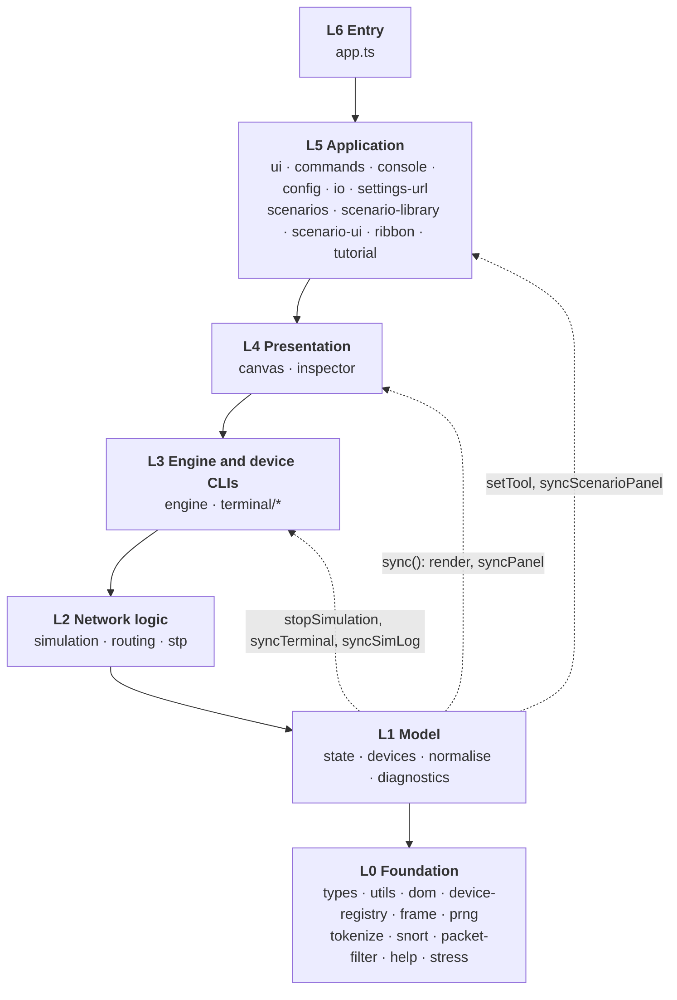
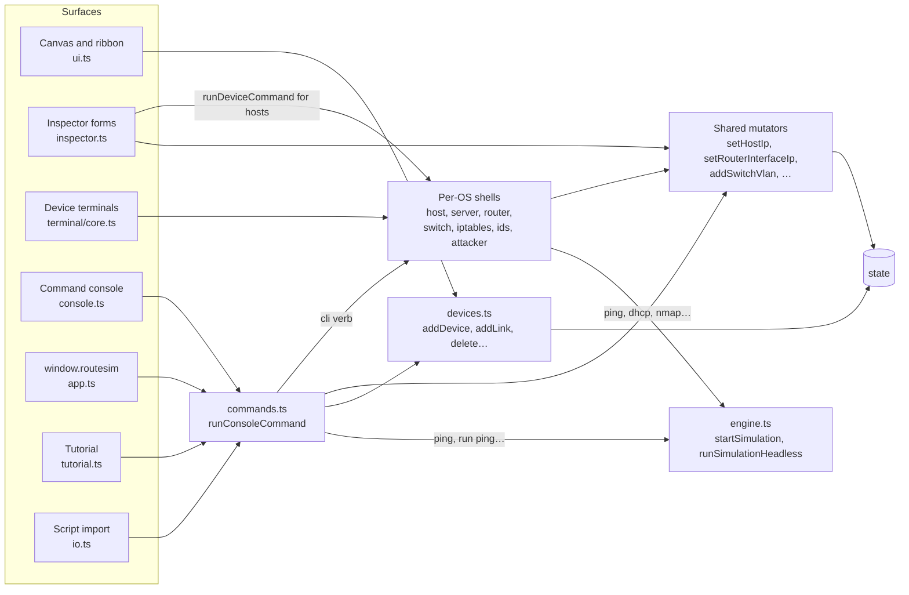
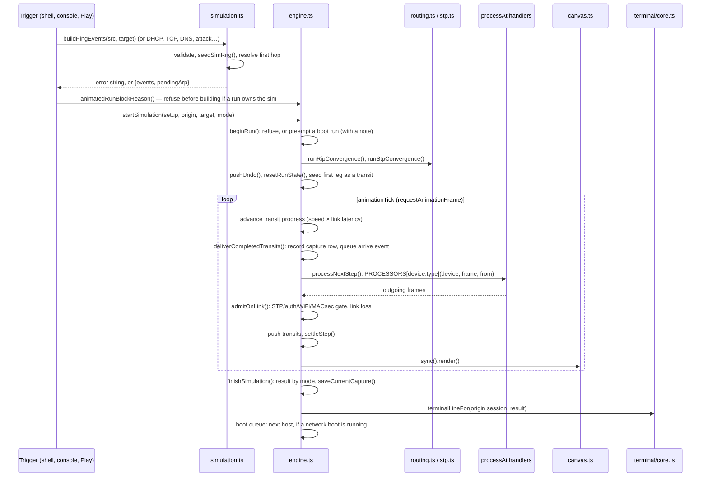

# Architecture

How the whole of RouteSim fits together: every source file, the layers they sit in, the shared state they all touch, and the paths a user action takes through them. The per-file documents in [src/](src/) go deep on each module; this document is the map that connects them.

**Contents**

1. [What the program is](#1-what-the-program-is)
2. [Repository layout](#2-repository-layout)
3. [The layers](#3-the-layers)
4. [Module catalogue](#4-module-catalogue)
5. [Shared state and the rules for changing it](#5-shared-state-and-the-rules-for-changing-it)
6. [The callback bridges](#6-the-callback-bridges)
7. [Import cycles: where they are and why they are safe](#7-import-cycles-where-they-are-and-why-they-are-safe)
8. [Four front doors, one set of actions](#8-four-front-doors-one-set-of-actions)
9. [The simulation pipeline](#9-the-simulation-pipeline)
10. [Topology lifecycle](#10-topology-lifecycle)
11. [Data model and persistence](#11-data-model-and-persistence)
12. [Scenarios, tutorial and help](#12-scenarios-tutorial-and-help)
13. [Build, test and tooling](#13-build-test-and-tooling)
14. [Extension recipes](#14-extension-recipes)
15. [Known structural warts](#15-known-structural-warts)

---

## 1. What the program is

RouteSim is a teaching simulator for network topologies. A learner draws devices on a canvas, cables them, configures them through GUI forms or per-device command lines modelled on real network operating systems, and then runs a **frame-level simulation**: real Ethernet frames (ARP, ICMP, DHCP, DNS, TCP/HTTP, 802.11, 802.1X, BPDUs) are processed hop by hop and animated across the wires.

Three properties shape the whole codebase:

- **One self-contained artefact.** The build produces a single `rs-web.html` with all JavaScript and CSS inlined and no runtime requests. Built-in topologies and scenarios are compiled in. Persistence is file download and file picker only.
- **No framework.** Rendering is imperative. `render()` redraws the whole canvas; `syncPanel()`, `syncTerminal()`, `syncSimLog()` and friends rebuild their panel's HTML from `state`. There is no virtual DOM and no reactive store.
- **One mutable state object.** Everything lives in `state` (`src/state.ts`). Modules read and write it directly, then call the right `sync*()` to repaint.

The toolchain is esbuild plus bun. See [build.md](build.md).

## 2. Repository layout

| Path | What it is |
|---|---|
| `src/` | All application source (TypeScript). 43 files, about 18,000 lines. Entry point `src/app.ts`. |
| `src/terminal/` | The per-device command lines: dispatch core plus one module per emulated OS. |
| `template.html` | The page skeleton: ribbon, canvas, inspector, dock, modals. Contains `{{STYLES}}` and `{{SCRIPT}}` placeholders. |
| `styles.css` | All styling, including the three theme blocks and per-device palette variables. |
| `build.sh`, `build-inline.ts` | The build: esbuild bundles `src/app.ts`, then `build-inline.ts` inlines CSS and JS into the template. |
| `rs-web.html` | The committed build output: the deliverable. |
| `tests/` | Bun test suite (about 50 files), the DOM stub preload, fixtures, benchmark harness. |
| `test-server.ts`, `test.html`, `benchmark.html` | Local dev server and browser UIs for running tests and benchmarks. |
| `tsconfig.json`, `tsconfig.tests.json` | Strict type-check configs for `src/` and for `tests/` plus `src/`. |
| `bunfig.toml` | Registers the test preload. |
| `scenario-solutions/` | Answer-key command scripts, one per built-in scenario, exercised by the test suite. |
| `docs/` | This documentation. `docs/src/` has one file per module or feature. |
| `reviews/` | Code-review documents and their resolution records. |
| `CLAUDE.md`, `ROADMAP.md`, `README.md` | Working conventions, forward plan, project readme. |

## 3. The layers

The modules fall into seven layers, L0 to L6. Arrows point from importer to imported. The model layer never imports a higher layer; where it must trigger work above it, it goes through a callback bridge (dashed arrows, see [section 6](#6-the-callback-bridges)). Above the model, a few imports do point sideways or back up within the top layers; [section 7](#7-import-cycles-where-they-are-and-why-they-are-safe) lists them.



What each layer owns:

| Layer | Owns | Rule |
|---|---|---|
| **L0 Foundation** | Types, pure helpers, static registries, parsers, the PRNG. | Imports nothing from the app except `types.ts` (and each other). Pure and trivially testable. |
| **L1 Model** | The `state` singleton, undo, device/link CRUD and lookups, config normalisation, invariant checks. | Never imports presentation or engine. Reaches upward only through callbacks. |
| **L2 Network logic** | Event setup for each run type, L2 reachability, the routing table and RIP, spanning tree. | Reads and writes device config; knows nothing about the DOM or animation. |
| **L3 Engine and CLIs** | Frame processing per device type, the run loop, packet capture; the emulated shells and their config mutators. | The engine and the terminal modules call each other (see [section 7](#7-import-cycles-where-they-are-and-why-they-are-safe)). |
| **L4 Presentation** | Canvas drawing and the inspector panel. | Reads `state`; the inspector edits config through the same mutators the CLIs use. |
| **L5 Application** | The command language, persistence, scenarios, tutorial, ribbon and event wiring. | Composes everything below. |
| **L6 Entry** | Registers the callbacks, wires the UI, exposes `window.routesim`, boots. | The only module that imports the whole graph. |

## 4. Module catalogue

Every source file, grouped by layer. Line counts are approximate and indicate weight, not precision.

### L0 Foundation

| File | Lines | Role | Key exports | Doc |
|---|---:|---|---|---|
| `types.ts` | 800 | Every interface: devices, the `DeviceConfig` superset, frames and payloads, simulation state, `AppState`. No runtime code. | `Device`, `DeviceConfig`, `EthernetFrame`, `SimulationState`, `AppState` | [types.md](src/types.md) |
| `utils.ts` | 230 | Pure helpers: IPv4 and MAC maths and validation, HTML escaping, the `cssColor` cache, port bounds. | `ipv4ToInt`, `cidrContains`, `escapeHtml`, `cssColor`, `MAX_PHYSICAL_PORT` | [utils.md](src/utils.md) |
| `dom.ts` | 90 | Cached `getElementById` references, resolved once at load. Mocked wholesale in tests. | `dom` | [dom.md](src/dom.md) |
| `device-registry.ts` | 300 | One spec per device type: label, name prefix, size, palette, icon paths, default config, default Ethernet port count, and the capability **roles** (host, single NIC, bootable, 802.1X supplicant, hostname, terminal). Code asks the role helpers instead of listing device types. | `DEVICE_SPECS`, `DEVICE_TYPES`, `freshNameCounters`, `defaultConfigFor`, `defaultPortCount`, `isHost`, `hasSingleNic`, `isBootable`, `isDot1xSupplicant`, `hasHostname`, `offersTerminal` | [devices.md](src/devices.md) |
| `frame.ts` | 470 | Factories for every frame kind plus label, colour and packet-list column helpers. | `createArpRequest`, `createIcmpEchoRequest`, `createBpduFrame`, `frameLabel`, `frameColor` | [frame.md](src/frame.md) |
| `prng.ts` | 60 | Per-run seeded PRNG for ports and transaction ids. Clock-seeded by default; `seed <n>` pins it. | `mulberry32`, `seedSimRng`, `simRandomInt`, `setSeedOverride` | [prng.md](src/prng.md) |
| `tokenize.ts` | 70 | Quote-aware tokenizer for the console language, and its inverse for export. | `tokenizeCommand`, `quoteArg` | [tokenize.md](src/tokenize.md) |
| `snort.ts` | 220 | A faithful subset of the Snort rule language: parse, match a frame, format a fast alert. | `parseRules`, `runIdsRules`, `formatAlert` | [ids.md](src/ids.md) |
| `packet-filter.ts` | 380 | Wireshark-style display filter for the packet list: protocol chips, device, expression grammar. | `applyLogFilter`, `compileFilter` | [packet-filter.md](src/packet-filter.md) |
| `help.ts` | 130 | The in-app Help guide: prose per device type and per setting. A test fails if one is missing. | `buildHelpHtml` | [help.md](src/help.md) |
| `stress.ts` | 135 | Seeded random command generator with a per-step invariant check. Dev tool behind the `stress` verb. | `runStressTest` | [testing.md](testing.md) |

### L1 Model

| File | Lines | Role | Key exports | Doc |
|---|---:|---|---|---|
| `state.ts` | 630 | The `state` singleton, the `sync()` callback registry, undo and redo, terminal-session helpers, themes, built-in topologies. | `state`, `sync`, `registerCallbacks`, `pushUndo`, `undo`, `redo`, `networkSnapshot` | [state.md](src/state.md) |
| `normalise.ts` | 600 | Turns untrusted or partial config into a valid shape. Defaults, router MAC generation, memoised port maps. The implicit import schema. | `normaliseConfig`, `ensureConfig`, `defaultDeviceConfig`, `memoPortModes` | [normalise.md](src/normalise.md) |
| `devices.ts` | 1,120 | Device and link CRUD, hit testing, O(1) lookup indexes, interface naming, port allocation, LAN collapse, the port picker, and its own callback bridge. | `addDevice`, `addLink`, `getDevice`, `linksFor`, `routerInterfacesWithNames`, `registerDeviceCallbacks` | [devices.md](src/devices.md) |
| `diagnostics.ts` | 90 | Read-only structural invariants: dangling links, stale selections, orphaned sessions, a run over a missing link. Empty array means healthy. | `diagnoseState`, `diagnoseRuntimeState` | [testing.md](testing.md) |

### L2 Network logic

| File | Lines | Role | Key exports | Doc |
|---|---:|---|---|---|
| `simulation.ts` | 620 | Builds the opening event queue for each run type (ping, DHCP, TCP, HTTP, DNS, WiFi, 802.1X, STP, attacks). Validates first, so errors return a string. L2 reachability through VLANs and gates. | `buildPingEvents`, `buildDhcpEvents`, `buildAttackEvents`, `l2Reachable`, `findPingTarget` | [simulation.md](src/simulation.md) |
| `routing.ts` | 310 | Router forwarding: the merged connected, static, internet-default and RIP table; longest-prefix lookup; RIP convergence with split horizon. | `buildRoutingTable`, `routingLookup`, `runRipConvergence` | [engine.md](src/engine.md) |
| `stp.ts` | 260 | 802.1D spanning tree: root election per component, port roles, blocking alternate links. Mutates config in place, like RIP. | `runStpConvergence`, `isRootBridge` | [stp.md](src/stp.md) |

### L3 Simulation engine and device CLIs

| File | Lines | Role | Key exports | Doc |
|---|---:|---|---|---|
| `engine.ts` | 2,760 | The run loop (process and animate), one `processAt<Type>` handler per device type, NAT, stateful firewalling, DHCP servers, the packet capture and its history, network boot, headless runs, traceroute, the sim-log pane. | `startSimulation`, `stopSimulation`, `stepOnce`, `runSimulationHeadless`, `runTraceroute`, `startNetworkBoot`, `syncSimLog` | [engine.md](src/engine.md), [nat.md](src/nat.md), [firewall.md](src/firewall.md), [red-team.md](src/red-team.md) |
| `terminal/core.ts` | 350 | Terminal sessions, the bottom dock (terminals, console, sim log), prompt and history, and `CLI_DISPATCH` by device type. | `runTerminalCommand`, `openTerminalFor`, `syncTerminal`, `terminalLineFor`, `runDeviceCommand` | [terminal.md](src/terminal.md) |
| `terminal/host.ts` | 350 | Linux shell for PCs: `ip`, `arp`, `ping`, `traceroute`, `nslookup`, `nc`, `dhcp`. Host mutators shared with the inspector. | `runHostTerminalCommand`, `setHostIp`, `setHostGateway` | [terminal.md](src/terminal.md) |
| `terminal/server.ts` | 135 | Host shell plus dnsmasq: conf directives and `systemctl`. | `runServerTerminalCommand`, `applyDnsmasqConfLine` | [dns.md](src/dns.md) |
| `terminal/router.ts` | 840 | FRRouting vtysh: the mode state machine, interfaces and sub-interfaces, static routes, RIP, NAT, `?` help, abbreviation. | `runRouterTerminalCommand`, `setRouterInterfaceIp` | [terminal.md](src/terminal.md) |
| `terminal/switch.ts` | 490 | SONiC: flat `config`/`show` commands for VLANs, membership, mirroring, STP. Switch mutators shared with inspector and console. | `runSwitchTerminalCommand`, `addSwitchVlan`, `setSwitchPortVlan` | [terminal.md](src/terminal.md) |
| `terminal/iptables.ts` | 235 | The shared netfilter command engine: parse, validate, list. Used by firewalls (FORWARD) and routers (INPUT and FORWARD). | `runIptablesCommand`, `ruleToIptables` | [firewall.md](src/firewall.md) |
| `terminal/firewall.ts` | 25 | The firewall device's shell: iptables on FORWARD only. | `runFirewallTerminalCommand` | [firewall.md](src/firewall.md) |
| `terminal/ids.ts` | 100 | Snort 3 on Linux: edit `local.rules`, read the alert log, `snort -T`. | `runIdsTerminalCommand` | [ids.md](src/ids.md) |
| `terminal/attacker.ts` | 70 | Kali shell for both offensive host types: `nmap`, `arpspoof`, falling through to the host shell. | `runAttackerTerminalCommand` | [red-team.md](src/red-team.md) |
| `terminal/index.ts` | 10 | Re-exports, so callers write `import … from "./terminal"`. | — | — |

### L4 Presentation

| File | Lines | Role | Key exports | Doc |
|---|---:|---|---|---|
| `canvas.ts` | 600 | All canvas drawing: grid, links, devices, badges, transit dots; pan and zoom; hit-testing transits. Reads `state`, never mutates the network. | `render`, `resizeCanvas`, `screenToWorld`, `fitNetwork`, `findTransitAt` | [canvas.md](src/canvas.md) |
| `inspector.ts` | 1,470 | The right panel: per-type config forms, link details, the clicked-frame field view, display options. Host edits are replayed as visible terminal commands. | `syncPanel`, `renderFramePanel`, `syncOptionControls`, `setNetworkPanel` | [inspector.md](src/inspector.md) |

### L5 Application

| File | Lines | Role | Key exports | Doc |
|---|---:|---|---|---|
| `commands.ts` | 1,340 | The app-level command language: tokenize, resolve device names, dispatch through the `COMMANDS` verb table to existing actions. Also the topology-to-script exporter. No UI of its own. | `runConsoleCommand`, `runConsoleScript`, `exportTopologyScript` | [scripting.md](scripting.md) |
| `console.ts` | 85 | The console pane UI that feeds `runConsoleCommand`. | `submitConsoleCommand`, `syncConsole` | [scripting.md](scripting.md) |
| `config.ts` | 290 | Serialise the live network to a payload; apply a payload back (stop run, normalise, replace, drop sessions, refit); load built-ins. | `buildConfigPayload`, `applyConfig`, `applyConfigWithoutUndo`, `loadTopology` | [config.md](src/config.md) |
| `io.ts` | 165 | File download and file picker for configs, scenarios, scripts and logs. | `exportConfig`, `importConfig`, `runImportedScript` | [scripting.md](scripting.md) |
| `settings-url.ts` | 110 | Parse display and sim settings from the query string, and build the inverse shareable query. Pure parser. | `parseSettingsFromUrl`, `buildSettingsQuery` | [settings-url.md](src/settings-url.md) |
| `scenarios.ts` | 220 | The scenario model, registry and goal checker. Checks run headless simulations. | `SCENARIOS`, `loadScenario`, `checkScenario`, `registerScenario` | [scenarios.md](scenarios.md) |
| `scenario-library.ts` | 820 | The built-in curriculum: topology plus goal checks for each challenge. Data only. | `CURRICULUM` | [scenarios.md](scenarios.md) |
| `scenario-ui.ts` | 70 | The floating goal banner and its Check button. | `syncScenarioPanel`, `runActiveScenarioCheck` | [scenarios.md](scenarios.md) |
| `ribbon.ts` | 60 | Ribbon tab switching and the scenario menu entries. | `setupRibbon` | [ribbon.md](src/ribbon.md) |
| `ui.ts` | 790 | Every DOM event listener: ribbon actions, tools, canvas pointer and wheel, keyboard shortcuts, themes, modals, settings pane. | `setupUI`, `setTool`, `setTheme`, `handleGlobalKeydown` | [ui.md](src/ui.md) |
| `tutorial.ts` | 355 | Auto-playing demo: a faux cursor drives real console commands, as one undo point. | `setupTutorial`, `startTutorial`, `buildSteps` | [tutorial.md](src/tutorial.md) |

### L6 Entry

| File | Lines | Role | Doc |
|---|---:|---|---|
| `app.ts` | 100 | Registers both callback bridges, calls `setupUI()` and `setupTutorial()`, installs `window.routesim`, applies URL settings, loads the Basic Network, first render. No exports. | [app.md](src/app.md) |

## 5. Shared state and the rules for changing it

`state` (in `state.ts`, typed as `AppState`) holds two kinds of data side by side:

- **Persistent network**: `devices` and `links`. Each `Device` carries its whole configuration in `device.config`, including runtime tables such as ARP caches and MAC tables.
- **Transient UI and run state**: selection, tool, pan and zoom, drag state, display options, theme, the `simulation` sub-state, terminal sessions, the dock, the console, saved captures, the active scenario, and the undo and redo stacks.

The undo system, not the type, decides which is which: `networkSnapshot()` deep-copies only the persistent network and strips derived data. Five rules keep the model consistent. Every mutating path in the codebase follows them, and the tests pin them.

1. **Validate, then `pushUndo()`, then mutate.** A rejected command must not leave an undo entry behind. Mutators return a message string, and callers detect errors by prefix.
2. **One user action is one undo point.** Multi-command operations set `state.isApplyingCompositeChange` after their single `pushUndo()`, so the inner mutators do not push their own. The tutorial and script import use this. Inspector text fields push once on focus (`captureUndoOnFocus`), not per keystroke. The stack is capped at 80 entries, and any push clears redo.
3. **Mutate, then sync.** After changing `state`, call the matching `sync().render()`, `sync().syncPanel()`, `sync().syncTerminal()` and so on. Nothing repaints automatically.
4. **Reassign or push collections; never splice them silently.** `devices.ts` keeps lazy `Map` indexes (`getDevice`, `linksFor`, `linkById`) that rebuild when the array's identity or length changes. In-place field edits are fine, because the index holds object references.
5. **Stop a live run before replacing the topology.** Undo, redo, loading a config, loading a scenario and clearing the network all call `stopSimulation` first; a headless run (scenario checks, `run`, traceroute) stops it through the engine's `beginRun`. See [section 10](#10-topology-lifecycle).

Derived state is recomputed, not stored. RIP-learned routes, spanning-tree roles, conntrack, IDS alerts, attack logs and frame history are rebuilt at each run and never serialised. That is why a removed link cannot leave a stale route behind. Switch MAC tables are learnt during runs and do persist between them, so they are **invalidated** instead: every link change ends with `linksChanged(ids)` (`state.ts`), which flushes the learnt entries on the affected L2 domain and recomputes the spanning tree; topology load, undo and redo flush every bridge.

## 6. The callback bridges

Low layers sometimes need to trigger high-layer work: an undo must repaint the canvas, a device configure must switch the tool and open a terminal. Direct imports would make the most-imported modules depend on the least-imported ones. Two registries invert those edges instead. `app.ts` fills both at startup, and tests register no-op versions.

**`registerCallbacks()` in `state.ts`**, read by any module through `sync()`:

| Callback | Wired to | Typical callers |
|---|---|---|
| `render` | `canvas.render` | Nearly every mutation path |
| `syncPanel` | `inspector.syncPanel` | Selection and config changes |
| `syncTerminal` | `terminal.syncTerminal` | Session changes, undo |
| `resizeCanvas` | `canvas.resizeCanvas` | Panel open and close |
| `syncScenarioPanel` | `scenario-ui.syncScenarioPanel` | Scenario load, check, dismiss |
| `syncCoordReadout` | `ui.syncCoordReadout` | Selection changes |
| `syncOptionControls` | `inspector.syncOptionControls` | Settings changes from console or URL |
| `recomputeStp` | `stp.runStpConvergence` then `render` | STP config edits, and every link change through `state.linksChanged` (which first flushes learnt MAC tables), so blocked links show live |
| `syncSimLog` | `engine.syncSimLog` | Capture view and filter changes |
| `stopSimulation` | `engine.stopSimulation` | `undo`, `redo`; optional in the type |

**`registerDeviceCallbacks()` in `devices.ts`**:

| Callback | Wired to | Why |
|---|---|---|
| `setTool` | `ui.setTool` | Configure is one-shot and reverts to the select tool |
| `setNetworkPanel` | `inspector.setNetworkPanel` | CRUD opens or closes the device list |
| `openTerminal` | `terminal.openTerminalFor`, gated on `canOpenTerminal` | Configuring a CLI device opens its shell |
| `stopSimulation` | `engine.stopSimulation` | `clearNetwork` tears the run down first |
| `linkUp` | Nothing registers it | Vestigial: first boot moved to the Play button (`startNetworkBoot`) |

## 7. Import cycles: where they are and why they are safe

The graph is **not** acyclic. A strongly-connected-components pass over the value imports finds two cycles:

- **Engine and terminals.** `engine.ts` imports `terminal/` to write run results into the origin device's session. `terminal/host.ts`, `router.ts` and `attacker.ts` import `engine.ts` to start runs and read routing. Inside `terminal/`, `core.ts` imports every shell for its dispatch table, and every shell imports `core.ts` to print.
- **Application layer.** `ui.ts` imports `config.ts`, `console.ts` and `io.ts`. `config.ts` and `commands.ts` import `setTool` and `setTheme` back from `ui.ts`. That upward pair closes a loop through `commands`, `console`, `config`, `io`, `scenarios`, `scenario-ui`, `ribbon` and `ui`.

ES modules tolerate cycles provided no module **uses** a cross-cycle import while it is being evaluated. The rule in this codebase is therefore: **inside a cycle, imported functions are called only from function bodies, never at module top level.** Top-level code may use only acyclic imports. For example, `scenarios.ts` builds `SCENARIOS` at load from `scenario-library.ts` and `normalise.ts`, neither of which is in its cycle. Break that rule and esbuild's bundle will hit a temporal-dead-zone error at startup, which no unit test catches because tests import modules individually.

The model layer (`state`, `devices`, `normalise`) is outside both cycles, and the callback bridges exist to keep it that way.

## 8. Four front doors, one set of actions

A user can change the network through four surfaces. They all converge on the same mutators, which is why a GUI edit, a typed CLI command, a console verb and a replayed script produce identical results and identical undo behaviour.



Notable joins:

- **`cli <device> <line>`** in the console runs a line through the device's real shell, attaching to (or silently creating) that device's terminal session. Router mode survives between lines, so a multi-line vtysh script works.
- **The inspector replays host edits as shell commands.** Changing a PC's IP in the form runs `ip addr add …` through `runDeviceCommand`, which echoes it in the terminal with an "injected" style. Invalid input fails exactly as it would when typed.
- **The tutorial and script import** both drive `runConsoleCommand`, wrapped in one undo point.
- **`exportTopologyScript`** is the inverse of all of this: it serialises the live network as a command script that replays to the same topology. Links are emitted before per-device configuration, because interface commands need the cable to exist.

A console line goes through `tokenizeCommand` (quotes group a token; an unterminated quote is an error), then a lookup in the `COMMANDS` verb table. Each handler receives the parsed arguments plus the raw tail of the line, so free-text payloads such as a Snort rule or a shell command arrive unsplit. Handlers return a `CommandResult` of `{ ok, output, data? }`. For headless runs `data` carries the `SimResult`.

## 9. The simulation pipeline

A run has three stages: **setup** in `simulation.ts`, **process** and **animate** in `engine.ts`, and **finish**.



**Ownership.** One run owns `state.simulation` at a time. Both entry points go through `beginRun` in `engine.ts`, which performs the one shared reset of the per-run state and settles whatever is in flight first: a new animated run is refused while the user's animated run is running or paused, a network-boot run is preempted (and its queue cancelled), and a headless run stops an animated one first. Every preemption leaves a note in the interrupted run's terminal, on the status line and in the console output. The terminal input lock is derived in `syncTerminal` from the same policy (`animatedRunBlockReason`), scoped to the shell that started the run. See [engine.md](src/engine.md#run-ownership).

**Setup.** Each `build*Events` function validates the request and returns either an error string or a starting queue of `SimEvent`s plus a `pendingArp` map of frames waiting on ARP resolution. Because validation returns before any run starts, every shell command's error path is testable without the engine.

**Process.** `processNextStep()` dequeues one event and calls the handler for the receiving device's type from the `PROCESSORS` map:

| Handler | Device types | Behaviour |
|---|---|---|
| `processAtComputer` | computer, laptop | ARP, ICMP echo, DHCP client, TCP handshake, HTTP, DNS client, WiFi association, 802.1X supplicant |
| `processAtServer` | server | dnsmasq DNS and DHCP, then everything a computer does |
| `processAtSwitch` | switch, access-point | MAC learning, flooding, 802.1Q access and trunk ports, SPAN mirroring, BPDU relay, 802.1X authenticator |
| `processAtRouter` | router | ARP, DHCP server, TTL and ICMP errors, routing, NAT and port-forwarding, INPUT and FORWARD filtering |
| `processAtInternet` | internet | L3 transit between cabled routers by destination subnet |
| `processAtHub` | hub | Repeats every frame out every other port |
| `processAtFirewall` | firewall | Transparent bridge with stateful FORWARD filtering and REJECT responses |
| `processAtIds` | ids | Passive sink: runs Snort rules on mirrored frames and records alerts |
| `processAtAttacker` | attacker, kali | Host behaviour plus scan and sweep tallies in attack mode |

Every outgoing frame passes through **`admitOnLink`**, the single admission point. It applies the data-plane gates (a spanning-tree-blocked link, unauthorised 802.1X port, unassociated WiFi, unkeyed MACsec) and per-link loss. Control frames such as BPDUs and EAPOL are exempt from the gates.

**Animate.** The animated path creates an `ActiveTransit` per admitted frame and moves it along the link each animation frame; the link's `latency` scales its crossing time. On arrival `deliverCompletedTransits` records a capture row (the Wireshark-style packet list) and queues the arrive event. Silent frames, such as hidden BPDUs, are processed without drawing. Broadcast storms are capped and reported.

**Headless.** `runSimulationHeadless` runs the same handlers but drains the queue synchronously with no animation, no capture and no loss. It returns a `SimResult`. It backs the console's `run` verb, scenario checks, `traceroute`, `window.routesim`, and most tests.

**Finish.** `finishSimulation` writes a mode-specific result (ping statistics, DHCP lease, nmap-style report and so on) into the **origin device's** session, even if another tab is active. It archives the capture for the multi-run compare view, then advances the network-boot queue. Play while idle calls `startNetworkBoot`, which boots every unconfigured cabled host in turn over animated DHCP, falling back to APIPA when enabled, then launches any ready Red Team actor.

**Determinism.** Protocol-visible random values come from `prng.ts`, reseeded by each `build*Events` call. By default the seed comes from the clock, so traffic varies like a real network. `seed <n>` pins it, making runs bit-for-bit reproducible.

## 10. Topology lifecycle

Many paths replace the whole network. All of them must leave no trace of the previous one: no running animation, no transit pointing at a deleted link, no selection or terminal session for a vanished device.

| Path | Entry | Stops the run through | Also resets |
|---|---|---|---|
| Load built-in or imported config | `config.applyConfig` / `applyConfigWithoutUndo` | direct call | Selection, sessions, name counters, scenario, view fit |
| Load a scenario | `scenarios.loadScenario` → `applyConfig` | via `applyConfig` | Sets the active scenario |
| Undo and redo | `state.undo` / `redo` → `restoreSnapshot` | `sync().stopSimulation` | Drops sessions for devices the snapshot lacks |
| Clear the network | `devices.clearNetwork` | device callback `stopSimulation` | Sessions, captures, selection |
| Scenario Check (and any headless run) | `scenario-ui.runActiveScenarioCheck` → `runSimulationHeadless` | `engine.beginRun` (with a surfaced note) | Headless checks then run on a quiet model; a queued network boot is cancelled |
| Script import | `io.runImportedScript` | per command | One undo point for the whole script |

`diagnoseState()` in `diagnostics.ts` is the executable form of these guarantees. `tests/lifecycle.test.ts` drives each path mid-run and asserts the result is empty. `window.routesim.diagnose()` runs the same check in the live app.

## 11. Data model and persistence

**Types.** `Device.config` is typed as `DeviceConfig`, an all-optional superset of every per-type config rather than a discriminated union. This gives real type checking on field names and shapes without narrowing at hundreds of generic access sites. See [types.md](src/types.md).

**Normalisation is the schema.** Anything entering the model from outside passes through `normalise.ts`: built-in topologies, imported JSON, scenario topologies, snapshot restores. The normalisers accept `unknown`, coerce or drop bad fields, and never throw. `ensureConfig` is the standard way to guarantee a config exists before mutating it.

**Interface identity.** Router interface configuration is keyed on the **peer device**, not the interface name, so it survives re-cabling. Names are positional for auto-assigned cables and pinned when the user chose a port. Sub-interfaces key on peer plus VLAN tag. Routes carry the same peer-and-tag identity. See [devices.md](src/devices.md).

**Formats.**

| Format | Produced by | Consumed by | Notes |
|---|---|---|---|
| Topology JSON | `config.buildConfigPayload` | `config.parseConfig` → `applyConfig` | Normalised devices and links; derived state omitted. An exhaustiveness test requires a payload branch per device type. |
| Command script | `commands.exportTopologyScript` | `runConsoleScript`, `io.runImportedScript` | Human-readable, replayable; names quoted as needed. |
| Scenario JSON | `io.exportScenarios` | `io.importScenario` → `registerScenario` | Checks validated with `isValidScenarioCheck`. |
| Event log JSON | `io.exportLog` | `io.importLog` | The narrative sim event log, not the packet capture. |
| URL query | `settings-url.buildSettingsQuery` | `parseSettingsFromUrl` in `app.ts` | Display options, speed, theme. Unknown keys are reported, not dropped silently. |
| In-memory slot | console `save` | console `load` | `state.configStore`, lost on reload. |

## 12. Scenarios, tutorial and help

**Scenarios** are data: a starting topology plus a list of `ScenarioCheck`s (link exists, config field equals, ping succeeds or fails, TCP, HTTP, DNS, DHCP, IDS alert). `loadScenario` applies the topology; `checkScenario` evaluates each check, running headless simulations for the traffic kinds. `scenario-ui.ts` shows the goal banner. Each built-in scenario has an answer-key script in `scenario-solutions/`, and the test suite replays every one and expects its checks to pass. See [scenarios.md](scenarios.md).

**The tutorial** builds a small network in front of the learner. It moves a fake cursor to real UI elements, then fires the equivalent console command, so what the learner watches is exactly what they would build by hand. It runs as a single undo point and ignores keyboard shortcuts while a field has focus. See [tutorial.md](src/tutorial.md).

**Help** is generated by `help.ts` from `DEVICE_SPECS` plus per-type prose. `tests/help.test.ts` fails when a device type or setting has no entry.

## 13. Build, test and tooling

**Build.** `bash build.sh` runs esbuild on `src/app.ts` to produce one IIFE, then `build-inline.ts` substitutes the CSS and JS into `template.html` to write `rs-web.html`. esbuild strips types without checking them, so the type check is separate. See [build.md](build.md).

**The green check.** A change is ready when all four pass:

```bash
bunx tsc --noEmit
bunx tsc --noEmit -p tsconfig.tests.json
bun test $(ls tests/*.test.ts | grep -v bench)
bash build.sh
```

**Test harness.** `bunfig.toml` preloads `tests/preload.ts`, which stubs `document`, `window` and `requestAnimationFrame` and mocks `dom.ts` with a proxy. Tests import modules directly, never `app.ts`. They call `registerNoopCallbacks()` once and `resetState()` before each test; `resetState` does not re-register callbacks. Animated runs need a no-op rAF and manual `stepOnce()` pumping. Fixtures live in `tests/fixtures.ts`. See [testing.md](testing.md).

**Benchmarks.** `tests/bench.test.ts` guards the hot paths with p99 budgets: the lookup indexes, L2 reachability, the per-device handlers, routing, RIP and STP convergence, and the packet-list filter. See [benchmarking.md](benchmarking.md).

**Diagnostics and stress.** `diagnostics.ts` supplies the invariants. `stress.ts` generates seeded random command sequences and checks the invariants after each step; it runs under `bun test tests/stress.test.ts` or, destructively, as the `stress` console verb.

**Dev server.** `bun test-server.ts` serves the app, `test.html` and `benchmark.html`, and runs tests on request. It binds to loopback by default and only serves known static types.

## 14. Extension recipes

**Add a device type.**

1. Add the type to `DeviceType` and its config fields to `types.ts`.
2. Add a `DEVICE_SPECS` entry in `device-registry.ts`: label, prefix, size, palette, icon, defaults, `defaultPorts` (if it has an Ethernet port count), and its `roles` — `host` (an IP end-system: ping/name target, inspector host fields, IP label, a MAC on creation), `singleNic` (one cable, no port picker), `bootable` (Play network-boots it), `dot1xSupplicant`, `hostname` and `terminal` (`true`, `false`, or `"managed"` for "only with the management plane on"). Every capability check reads these through `isHost`/`hasSingleNic`/`isBootable`/`isDot1xSupplicant`/`hasHostname`/`offersTerminal`, so a correct entry classifies the type everywhere at once — never add a hand-written list of device types. `tests/device-registry.test.ts` checks that each consumer agrees with the spec for every type.
3. Add normalisation in `normalise.ts` and a payload branch in `config.ts`. The exhaustiveness test enforces the second.
4. Add `processAt<Type>` to `engine.ts` and register it in `PROCESSORS`.
5. Optionally add a shell in `terminal/`, register it in `CLI_DISPATCH`, and give it a prompt in `terminalPromptText`. The registry test fails if `CLI_DISPATCH` and the `terminal` role disagree.
6. Add `--<palette>-*` CSS variables for every theme, and a tool button in `template.html`.
7. Add a help entry in `help.ts`. The help test enforces it.

**Add a console verb.** Write a `cmd<Verb>` handler in `commands.ts` that validates, calls an existing mutator, and returns `ok()` or `err()`. Register it in `COMMANDS` and `HELP`. If it changes persistent config, make sure `exportTopologyScript` can emit it so the round-trip holds, and document it in [scripting.md](scripting.md).

**Add a shell command.** Add the case in the right `terminal/` module. Put state changes in an exported mutator so the inspector and console can share it, following validate, `pushUndo`, mutate.

**Add a scenario.** Add an entry to `CURRICULUM` in `scenario-library.ts` and an answer-key script in `scenario-solutions/`. See [scenarios.md](scenarios.md).

**Add a URL setting.** Add a row to the table in `settings-url.ts`. Parsing and the shareable-query inverse both follow.

## 15. Known structural warts

These are recorded rather than fixed. None is a correctness problem today.

- **`config.ts` and `commands.ts` import `setTool` and `setTheme` from `ui.ts`.** This is what closes the application-layer cycle. Routing both through the callback registry would break it.
- **`terminal/router.ts` imports routing functions from `engine.ts`**, which only re-exports them from `routing.ts`. Importing `routing.ts` directly would take the router shell out of the engine's import set, though the engine-to-terminal cycle would remain.
- **The `linkUp` device callback is vestigial.** `devices.addLink` still fires it, but nothing registers it.
- **Interface references by name do not follow renumbering.** RIP passive interfaces and pre-cable interface config are stored by name. Peer-keyed state is preferred for new features.
- **`engine.ts` is large.** At about 2,760 lines it holds the run loop, every device handler, NAT, firewalling and the sim-log UI. `routing.ts` and `stp.ts` have already been extracted; the per-device handlers are the natural next split.
